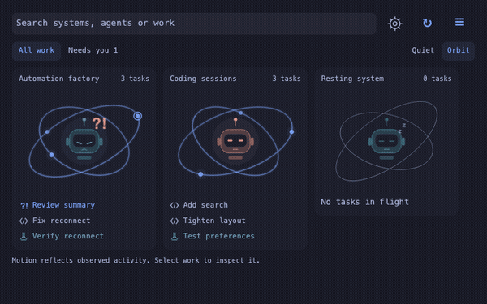
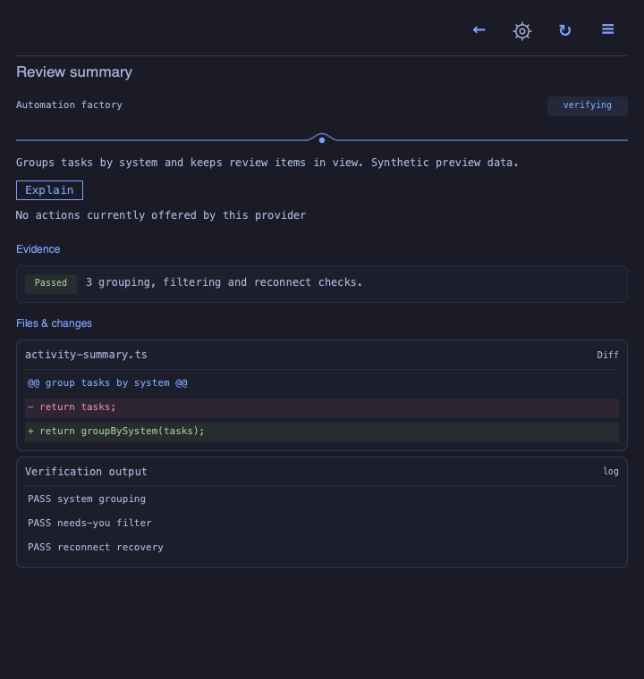

<h1 align="center">Miilo for Omarchy</h1>

<p align="center">
  
  
  
  
  
</p>

Your agents, with a little personality. An Omarchy bar plugin that opens Miilo's
robot fleet, searchable work, explanations and supported provider actions.

The plugin consumes a versioned shared renderer and delegates observation to the
native helper. Provider credentials and execution remain outside the UI.
Installed Omarchy acceptance is pending.

## Preview

<p align="center">
  
</p>

<p align="center"><sub>Native Qt render · sample systems and tasks · installed-host acceptance is separate.</sub></p>

<details>
<summary>Inspect evidence and file changes</summary>

<p align="center"></p>

</details>

## Install

Requires Omarchy Quattro with its plugin commands, Quickshell/Qt, Nerd Font icons,
`miilo-owl` 1.4.0 from miilo-owl-widgets, and `miilo-local` 0.2.0 from miilo-cli
for local session onboarding. Put both binaries on the shell's PATH first.
Download the matching helper and CLI binaries from their GitHub Releases.

Install the plugin, then validate it against your Omarchy shell version:

```sh
omarchy plugin add https://github.com/miilo-ai/miilo-omarchy-plugin.git
# Review the checkout before enabling it.
omarchy plugin enable io.miilo.bar
```

Click Miilo in the bar to open the dashboard. Escape closes it. **Local agents**
lets you select existing Codex/Cursor sessions; nothing is enrolled on install.
Local agents means sessions on this Omarchy computer, not on another device.
To view them from a phone, use an operator-provisioned observation endpoint;
local collection does not expose an API automatically. Read the
[phone and remote guide](https://github.com/miilo-ai/miilo-cli/blob/main/docs/PHONE_AND_REMOTE.md).
Tailscale, Miilo credentials, model credentials and agent sign-in are separate.
Local observations need neither CE nor a Miilo account. Native import can start
the owned `miilo-local-desktop.service` after you confirm your selection.
Local transcripts have no approval actions. Remote provider actions appear only
when the connected provider advertises them and existing access rules allow them.

The plugin runs in Omarchy's existing shell. It opens a floating dashboard window;
it is not yet an anchored clock-style popout. No second Quickshell process is started.
Snapshots are refreshed periodically; this renderer is not a push-only UI.

## Configure and remove

```sh
omarchy bar move io.miilo.bar --section right
omarchy-shell shell summon io.miilo.bar '{}'
omarchy-shell shell hide io.miilo.bar
omarchy plugin disable io.miilo.bar
omarchy plugin remove io.miilo.bar
```

For the preview-first removal wrapper in this checkout, run `bash uninstall.sh`
without arguments, review what remains, then run `bash uninstall.sh --confirm`.
It disables and removes only `io.miilo.bar` through Omarchy, and verifies absence.
Before deleting a clean Git installation, it saves the complete checkout, including
ignored files and unpublished history, in a private `checkout.tar` under
`$XDG_STATE_HOME/miilo/plugin-backups` (default `~/.local/state`). Backup failures
stop removal. Linked Git metadata requires manual preservation. An installation
path left behind despite absent inventory is reported as incomplete removal.
Verification waits up to ten seconds for asynchronous shell inventory updates;
unavailable inventory, invalid responses or a remaining install path fail visibly.
This source change does not add a private-data purge or remove shared helpers.
If the checkout was already removed, use the standard manager commands above;
see [the native validation handoff](.specify/handoffs/uninstall-validation.md).

Removing the plugin retains connections and observations. Stop the separately
owned collector explicitly if desired:
`systemctl --user disable --now miilo-local-desktop.service`.
Never run this against another user's service. Do not enable the old widgets
checkout's `io.miilo.bar` alongside this one: both use the same plugin identity.
Legacy `io.miilo.dashboard` / `io.miilo.desktop` installations are not removed.

## Develop

Inactive local sessions are hidden from the fleet and system selector by default.
Use **Show inactive sessions** to reveal them without changing enrollment. Sessions
with observed activity or pending decisions remain visible; idle remote factories
stay accessible. The setup enrollment picker retains its discovery inventory.

Update the checked native UI, back up the installed bar plugin, and reopen it:

```sh
bash tools/dev-relaunch.sh
# Rebuild/install miilo-owl and miilo-local too (needed for older installed binaries):
bash tools/dev-relaunch.sh --rebuild
# First shared user-configuration migration (keeps original files):
bash tools/dev-relaunch.sh --rebuild --migrate-config
# Full coordinated tests, then rebuild/migrate/relaunch only if they pass:
bash tools/qualify-user-config.sh --install
```

Requires sibling `miilo-owl-widgets` and `miilo-cli` checkouts, Cargo registry/Git
access for rebuilds, and normal user access to the plugin directory and desktop
socket. `--dry-run` prints the plan; `--no-restart` installs without restarting or
enabling the shell plugin. Checks/version mismatches stop before installation.
Relaunch enables the discovered plugin before restarting, then waits up to ten
seconds for its live bar widget to accept summon. A timeout returns failure.

For private SDK dependencies, the workflows use Git's CLI authentication. When
the sibling SDK checkout uses GitHub SSH, its SSH URL is applied to the pinned
HTTPS dependency through process-scoped Git configuration. Global Git settings
and dependency pins remain unchanged.

Rebuilds install both `miilo` and `miilo-local`. The opt-in `--migrate-config`
initializes `~/.miilo/` after installation and before relaunch; ordinary updates
do not migrate settings. Quit older Miilo clients before migration. Existing
collector configuration paths and service state are preserved.
The updater backs up the existing bar and any replaced binaries under
`$XDG_STATE_HOME/miilo/plugin-backups` (default `~/.local/state/miilo/plugin-backups`).
It leaves session/connection data and legacy dashboard/desktop plugins alone.

Install the companion skill once for discovery outside this repository:

```sh
bash tools/install-dev-skill.sh
```

It installs [miilo-desktop](skills/miilo-desktop/SKILL.md) in
`${CODEX_HOME:-$HOME/.codex}/skills`. Refresh skills/start a new agent session
afterward. The skill handles routine requested rebuild/relaunch work when the
session has the required access; it cannot bypass a managed sandbox.

`make check` runs portable source and installation checks with Node.js 22 or newer (development only). No npm packages are required. Preview capture uses native Qt 6 tools; shipped QML does not require Node.
On Omarchy, run `make check-native` against the installed shell. See
[the agent handoff](.specify/handoffs/omarchy-agent.md) and
[marketplace registration](docs/marketplace.md).

## Boundaries

| Repository | Owns |
| --- | --- |
| miilo-omarchy-plugin | Omarchy manifest, shell lifecycle, themes and presentation |
| miilo-owl-widgets | Shared OWL design, vendored evaluator and miilo-owl helper |
| miilo-cli | Native miilo-local discovery, consent and observation collector |
| miilo-sdk | Contracts and shared observation domain |
| miilo-ce | Optional self-hosted HTTP/auth transport |

Renderer inputs and their hashes are recorded in `sources.lock.json`.
Native integration fixes belong here; shared renderer fixes must be coordinated
with the widgets repository. Update the lock intentionally after reviewing diffs.
The shared widgets repository is `miilo-ai/miilo-owl-widgets`. Review the actual
source revision and hashes before updating the renderer lock.

MIT. Upstream renderer notices remain in `vendor/owl/LICENSE` and `vendor/owl/UPSTREAM.md`.
Contact: contact@miilo.tech. Maintained by Viratec Interactive LLC.

## Source layout

`ui/shell` adapts Omarchy lifecycle and theme tokens. `ui/components` holds
presentation. Onboarding has separate state/controller, helper command adapter,
invitation, group editor, session list and shared controls. `vendor/owl` contains
the attributed evaluator; `assets` contains generated OWL. No provider engine or
credential storage lives in QML. Authored QML modules are limited to 200 lines.

Native design: [Compact / Detail and your local crew](docs/orbit-design.md).
Existing work/consent rules remain unchanged; native qualification is still required.

Development and preview tooling: [toolchain guide](docs/development-toolchain.md).
