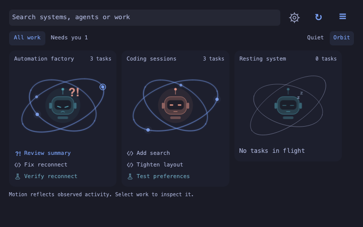
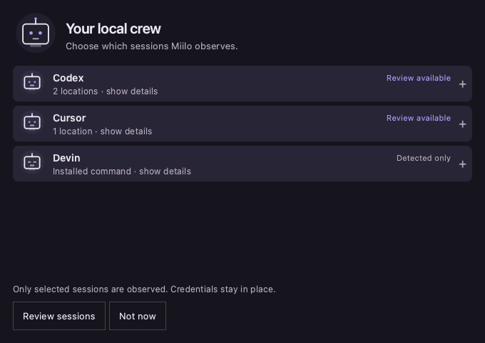
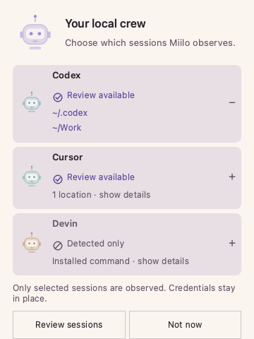
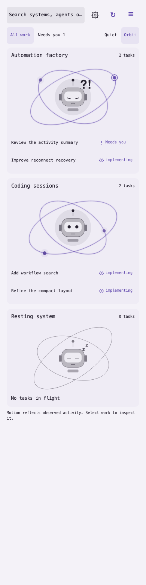

# Quiet / Orbit and your local crew

The plugin consumes the shared Orbit widget asset pinned in sources.lock.json.
The expanded view offers Quiet/Orbit; existing installations default to Quiet.
Full/Reduced/Off remain independent motion settings. No helper protocol change or
new CLI binary is required by this presentation increment.

Onboarding now has an original robot header, compact agent rows and expandable
locations. Agent rows distinguish review availability from detection-only; neither
means connected. Session selection, grouping, future enrollment opt-in, credentials
and command/controller boundaries remain unchanged. Review groups also have small
static robot markers. The active native agent must reconcile any additional local
typography changes before updating an installed checkout.

## Local checks

Run make check. Optional real Qt component render (developer dependency only):

```sh
uv run --with PySide6-Essentials python tools/render-crew.py /tmp/miilo-crew-preview
```

This executes actual QML and a row click, captures dark/expanded/narrow-light states
and fails on QML warnings. A test-only Quickshell.env stub supplies a synthetic home;
no real discovery, import, helper command or Omarchy shell starts.

This repository now has tools/render-orbit.cjs for its own pinned OWL asset,
vendored evaluator, layout and Canvas with synthetic inventory. That fixture validates native row
selection into details. It is not proof of host integration or platform performance.

## Remaining machine checks

Pull the matching main revisions; do not overwrite uncommitted native work. Validate
and update the existing plugin deliberately. Check close/open, focus return, Escape,
search/filter, system pagination, scroll/touch, row selection, action confirmation,
light/dark themes, custom robot colors, text scaling and fractional display scaling.
Record frame/CPU/RSS cost and hidden/minimized behavior before claiming smoothness.
Off/reduced visuals are tested; complete cessation of native frame scheduling and
automatic OS motion preference detection remain unqualified. Android is separate.

Orbit glyphs are decorative in this candidate; stationary work rows are selectable.
Event-driven flashes, smooth membership transitions and glyph picking remain later
increments. No network links, approvals or completion are inferred from decoration.
No release tag, marketplace submission or publication is implied by this commit.

## Inspected fixture renders

These are actual Qt renders with synthetic inventory, not the installed Omarchy shell.







Robot identity correction: onboarding now executes assets/RobotProgram.js generated
from the exact original shared Bot source. RobotPortrait.qml only supplies theme,
size, saved colors and a clock to the existing OWL painter; it draws no independent
character geometry. Previews above have been refreshed to show that correction.

The combined filter/view row and larger original center robot are also checked
at narrow width:



## Crossed paths preview


[MP4 recording](images/orbit-crossed-qt-fixture.mp4). Both atom planes gently sweep around the centered original robot; their open
nucleus stays clear. Stable system offsets, subtle neon and muted dormant rings
match the approved motion study. Task dots stay on their assigned projected rail.
State labels now carry small accent-colored icons. Reduced/Off or stale sources
freeze orbital motion. The original shared robot and work detail actions remain.

This deterministic software Qt recording demonstrates geometry and layout, not
installed-shell performance or live provider activity. Native acceptance remains
with the Omarchy testing agent.
